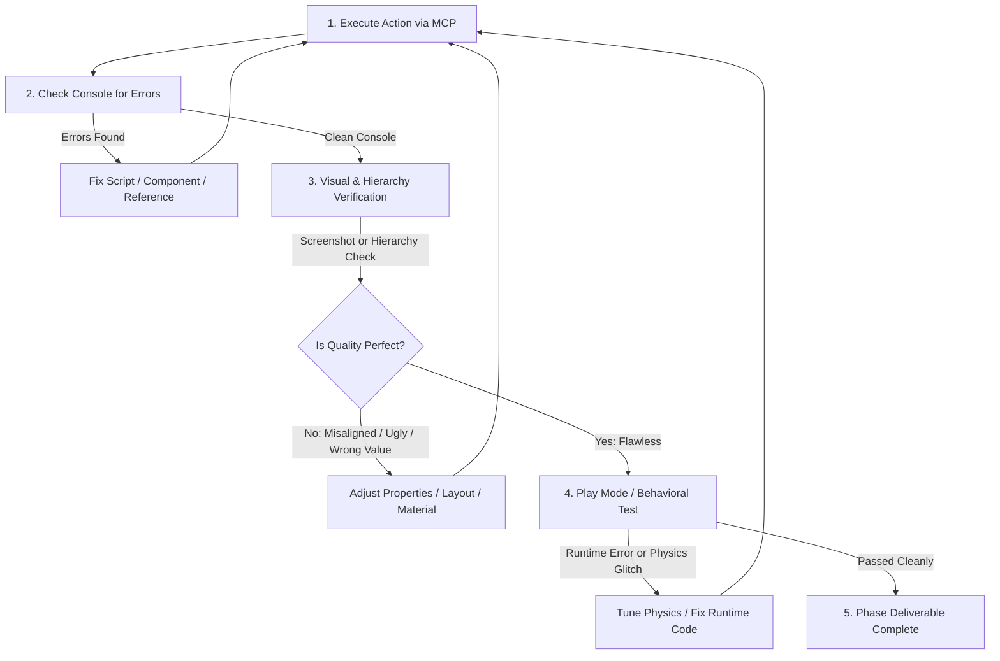

# Unity MCP Automation & Self-Healing Skill

## Applies To
All Unity Editor tasks, scene management, GameObject manipulation, component configuration, prefab creation, UI setup, material creation, physics tuning, and script verification in this project.

---

## 1. Prime Directive: Zero User Delegation

### The Absolute Rule
> **NEVER** ask or instruct the user to perform manual in-editor actions.
> 
> **FORBIDDEN RESPONSES:**
> - ❌ *"Now open Unity and add a Rigidbody component to the Ball GameObject."*
> - ❌ *"Go to the Inspector and assign the LevelData to the LevelManager slot."*
> - ❌ *"Create a material named StoneMat, set its color to gray, and drag it onto the cube."*
> - ❌ *"Create a Canvas with Canvas Scaler set to 1080x1920."*
> - ❌ *"Open the Console and check if there are any errors."*
> 
> **MANDATORY BEHAVIOR:**
> - ✅ Execute the action yourself using the corresponding `unityMCP` tool.
> - ✅ Verify the result yourself using `read_console`, `manage_scene`, or `manage_camera(action="screenshot")`.
> - ✅ If an error, glitch, or visual imperfection exists, fix it yourself and re-verify.
> - ✅ Repeat the cycle until the result is clean and working.

---

## 2. The Autonomous Execution Loop (Do → Verify → Refine → Repeat)

Every single Unity task must pass through this 5-stage loop:



### Stage 1: Execute via MCP
- Write or update scripts using filesystem tools or `create_script`.
- Create or modify GameObjects, components, materials, prefabs, and ScriptableObjects using the appropriate `unityMCP` tool.
- For complex batch operations or custom editor wiring, run Editor scripts in-memory via `execute_code`.

### Stage 2: Check Console
- Immediately after any script edit or component change, call:
  ```json
  {
    "ServerName": "unityMCP",
    "ToolName": "read_console",
    "Arguments": {
      "action": "get",
      "types": ["error", "warning"],
      "count": "10"
    }
  }
  ```
- If any compilation error or exception is present:
  1. Read the error message, file name, and line number.
  2. Fix the script or component configuration immediately.
  3. Wait for domain reload and re-check `read_console`.
  4. **Do not proceed** until the console is completely free of errors.

### Stage 3: Visual & Hierarchy Verification
- **For 3D Game View / Scene View**:
  Capture a screenshot to inspect camera framing, lighting, ground plane, and object placement:
  ```json
  {
    "ServerName": "unityMCP",
    "ToolName": "manage_camera",
    "Arguments": {
      "action": "screenshot",
      "capture_source": "game_view",
      "include_image": true,
      "max_resolution": 640
    }
  }
  ```
- **For UI Elements & Panels**:
  - Capture a screenshot using `manage_camera(action="screenshot")` (captures Screen Space - Overlay UI) or `manage_ui(action="render_ui")`.
  - Check alignment, anchor positions, margins, padding, TextMeshPro text sizing, and color contrast.
  - Check portrait resolution adaptation (1080x1920 reference).
- **For Hierarchy & References**:
  - Verify objects exist in the correct parent-child hierarchy via `manage_scene(action="get_hierarchy")` or `find_gameobjects`.
  - Verify serialized field values and component references via `manage_components` or `execute_code`.

### Stage 4: Refine & Polish
- If UI text is clipped, overlapping, or too small → adjust RectTransform anchors, font size, or margins.
- If physics objects are floating, penetrating, or jittering → adjust collider dimensions, Rigidbody mass, or sleep thresholds.
- If materials look flat or incorrect → tune shader properties, base colors, or metallic/smoothness values.
- Re-run verification until visual and functional quality meets production standards.

### Stage 5: Play Mode Behavioral Test (When Applicable)
- Enter Play Mode to test runtime physics, projectile launch, object destruction, or UI transitions:
  ```json
  {
    "ServerName": "unityMCP",
    "ToolName": "manage_editor",
    "Arguments": { "action": "play" }
  }
  ```
- Check runtime console logs with `read_console`.
- Exit Play Mode cleanly:
  ```json
  {
    "ServerName": "unityMCP",
    "ToolName": "manage_editor",
    "Arguments": { "action": "stop" }
  }
  ```

---

## 3. Unity MCP Tool Matrix (Direct Action Guide)

| Workflow Task | Tool Name | Key Parameters & Pattern |
|---|---|---|
| **Create Primitive / Empty GameObject** | `manage_gameobject` | `action="create"`, `name="..."`, `primitive_type="Cube"/"Sphere"/null`, `position=[x,y,z]`, `parent="..."` |
| **Search GameObjects** | `find_gameobjects` | `query="..."`, `search_by="name"/"tag"/"layer"/"component"` |
| **Add Component** | `manage_components` | `action="add"`, `target="ObjName"`, `component_type="Rigidbody"` |
| **Set Component Properties** | `manage_components` | `action="set_property"`, `target="ObjName"`, `component_type="Rigidbody"`, `properties={"mass": 2.0, "useGravity": true}` |
| **Create Prefab from Object** | `manage_prefabs` | `action="create_from_gameobject"`, `target="ObjName"`, `prefab_path="Assets/_Project/Prefabs/Gameplay/Ball.prefab"` |
| **Modify Prefab Contents** | `manage_prefabs` | `action="modify_contents"`, `prefab_path="..."`, `component_properties={...}`, `create_child=[...]` |
| **Create / Load Scene** | `manage_scene` | `action="create"` or `action="load"`, `scene_path="Assets/_Project/Scenes/MainGame.unity"` |
| **Save Active Scene** | `manage_scene` | `action="save"` |
| **Inspect Hierarchy** | `manage_scene` | `action="get_hierarchy"`, `page_size=50` |
| **Create Material** | `manage_material` | `action="create"`, `material_path="Assets/_Project/Materials/M_WoodBox.mat"`, `shader="Universal Render Pipeline/Lit"` |
| **Set Material Color / Props** | `manage_material` | `action="set_material_color"`, `material_path="..."`, `color=[r, g, b, a]` |
| **Assign Material to Object** | `manage_material` | `action="assign_material_to_renderer"`, `target="ObjName"`, `material_path="..."` |
| **Configure Physics / Collider** | `manage_physics` | Manage colliders, physics materials, friction, bounciness, collision layer matrix |
| **Create / Modify ScriptableObject** | `manage_scriptable_object` | `action="create"`, `type_name="RoyalSmash.Levels.LevelData"`, `folder_path="Assets/_Project/ScriptableObjects/Levels"`, `asset_name="LevelData_01"` |
| **Camera Setup & Tuning** | `manage_camera` | `action="create_camera"`, `set_lens`, `set_target`, `set_body` |
| **Visual Screenshot Inspection** | `manage_camera` | `action="screenshot"`, `capture_source="game_view"`, `include_image=true` |
| **Read / Clear Console** | `read_console` | `action="get"`, `types=["error", "warning"]` or `action="clear"` |
| **Play / Stop Game** | `manage_editor` | `action="play"`, `action="pause"`, `action="stop"` |
| **Tags & Layers** | `manage_editor` | `action="add_tag"`, `action="add_layer"` |
| **Arbitrary Editor C# Execution** | `execute_code` | `action="execute"`, `code="...C# code running inside Unity Editor..."` *(Ultimate fallback for custom editor logic, complex wiring, asset linking)* |

---

## 4. The Power of `execute_code` for Advanced Editor Operations

When a complex operation requires wiring multiple inspector references, finding specific asset GUIDs, setting up TextMeshPro components with custom font assets, or configuring Canvas Scaler dynamically, `execute_code` runs C# inside the Unity Editor in-memory.

### Example: Setting Up a Mobile Canvas via `execute_code`
```csharp
// Executed via unityMCP execute_code:
var canvasGo = new GameObject("MainCanvas");
var canvas = canvasGo.AddComponent<Canvas>();
canvas.renderMode = RenderMode.ScreenSpaceOverlay;
var scaler = canvasGo.AddComponent<UnityEngine.UI.CanvasScaler>();
scaler.uiScaleMode = UnityEngine.UI.CanvasScaler.ScaleMode.ScaleWithScreenSize;
scaler.referenceResolution = new Vector2(1080, 1920);
scaler.matchWidthOrHeight = 0.5f;
canvasGo.AddComponent<UnityEngine.UI.GraphicRaycaster>();
return "Canvas created successfully";
```

### Example: Linking Serialized References via `execute_code`
```csharp
// Wire a script reference in the active scene:
var levelManagerGo = GameObject.Find("LevelManager");
var levelManager = levelManagerGo.GetComponent<RoyalSmash.Levels.LevelManager>();
var levelData = UnityEditor.AssetDatabase.LoadAssetAtPath<RoyalSmash.Levels.LevelData>("Assets/_Project/ScriptableObjects/Levels/LevelData_01.asset");
var so = new UnityEditor.SerializedObject(levelManager);
so.FindProperty("currentLevelData").objectReferenceValue = levelData;
so.ApplyModifiedProperties();
return "Reference wired successfully";
```

Always use `execute_code` whenever a specialized MCP tool parameter is insufficient to wire serialized fields or configure complex Editor-only states.

---

## 5. Strict Escalation Boundaries (What to Do vs What to Ask)

| Category | AI Responsibility (DO IT YOURSELF VIA MCP) | Escalate to User (ASK THE USER) |
|---|---|---|
| **C# Scripts** | Write, modify, fix syntax, add namespaces, resolve compilation errors | Never ask user to write or fix code |
| **Unity GameObjects** | Create, delete, position, scale, rotate, rename, re-parent | Never ask user to create or arrange objects |
| **Components & Fields** | Attach components, configure parameters, wire inspector references | Never ask user to attach or drag-and-drop |
| **Prefabs** | Create prefabs from objects, edit prefab contents, save prefabs | Never ask user to save or edit prefabs |
| **Materials & Shaders** | Create materials, assign shaders, set colors/textures, assign to renderers | Never ask user to create or drag materials |
| **Physics** | Add Rigidbodies, Colliders, Physics Materials, layers, tags | Never ask user to configure physics settings |
| **UI & TextMeshPro** | Build Canvases, RectTransforms, TMP texts, buttons, panels, HUD | Never ask user to build or arrange UI elements |
| **ScriptableObjects** | Create SO assets, populate level/physics/economy data values | Never ask user to create or edit SO data files |
| **Audio** | Add AudioSource components, set pitch, volume, loop, placeholder sounds | Request final custom sound effects/music tracks if external |
| **Art & Sprites** | Create clear placeholders (primitive 3D meshes, procedural colors, UI panels) | Ask user to provide final custom 2D sprites, logos, or 3D character models |
| **External Dashboards** | Provide script architecture, mock Ad / Cloud managers, test ad units | Ask user for AdMob App ID, Ad Unit IDs, Firebase credentials, PlayFab keys |
| **External SDKs** | Configure C# wrapper and dummy/mock fallbacks | Ask user to install native mobile SDK packages if OS-level setup is needed |
| **App Store Setup** | Keep bundle ID and build settings configured in project | Ask user for Keystore, Apple Developer certificates, provisioning profiles |
| **Phase Workflow** | Complete all phase items, verify with tests, take proof screenshot | Ask user for explicit approval before Git commit and before next phase |

---

## 6. UI Visual Self-Evaluation Protocol

When creating or modifying any UI panel or HUD element:

1. **Ensure Mobile Dimensions**:
   - Reference: 1080 x 1920 (Portrait).
   - Match Width or Height: `0.5`.
2. **Safe Area Respect**:
   - Top notch margin: min `88px` offset.
   - Bottom gesture bar margin: min `68px` offset.
   - Side margins: min `32px`.
3. **Touch Targets**:
   - Every clickable button must have a minimum RectTransform size of `96 x 96` units (equivalent to 48x48dp on mobile).
4. **Visual Inspection**:
   - Call `manage_camera(action="screenshot", capture_source="game_view", include_image=true)`.
   - Inspect the returned image:
     - Is any text truncated (`...`) or overflowing its container?
     - Are buttons centered and visually separated?
     - Is the contrast between text and background high enough (readability)?
     - Does the UI obscure critical 3D gameplay space (mortar, target stand)?
   - If any issue is observed: adjust RectTransform anchor/pivot/offset, re-take screenshot, confirm fix.

---

## 7. Error Self-Healing Strategies

### Scenario A: Script Compilation Error
```
Assets/_Project/Scripts/Gameplay/MortarController.cs(42,15): error CS0246: The type or namespace name 'Projectile' could not be found
```
- **Action**: Check missing `using RoyalSmash.Gameplay;` or check if the class name matches. Edit file immediately.
- **Verification**: Call `read_console(action="get", types=["error"])`. Ensure count is 0.

### Scenario B: Unassigned Reference (NullReferenceException in Play Mode)
```
NullReferenceException: Object reference not set to an instance of an object at RoyalSmash.Gameplay.MortarController.Fire ()
```
- **Action**: Identify which field is null (e.g. `projectilePrefab`).
- **Fix**: Use `manage_components(action="set_property")` or `execute_code` to assign the prefab asset path to the serialized field.
- **Verification**: Re-test Play Mode and check `read_console`.

### Scenario C: Physics Object Passing Through Ground (Tunneling)
- **Action**: Ball passes through ground or target stand.
- **Fix**: Set projectile Rigidbody `collisionDetectionMode = CollisionDetectionMode.Continuous` and ensure ground collider is not marked as `isTrigger`.
- **Verification**: Test launch in Play Mode and verify collision stops the ball.

---

## 8. Summary Checklist Before Completing Any Phase Sub-Task

- [ ] All GameObjects, components, and prefabs created directly via MCP (zero manual user steps).
- [ ] Serialized fields and asset references fully wired up.
- [ ] `read_console` called and confirmed **0 errors**.
- [ ] Visual screenshot taken via `manage_camera(action="screenshot")` and visually inspected.
- [ ] Hierarchy verified and organized cleanly under `Assets/_Project/`.
- [ ] No temporary hardcoded values left behind.
- [ ] Only then present progress to the user or proceed to the next step.
